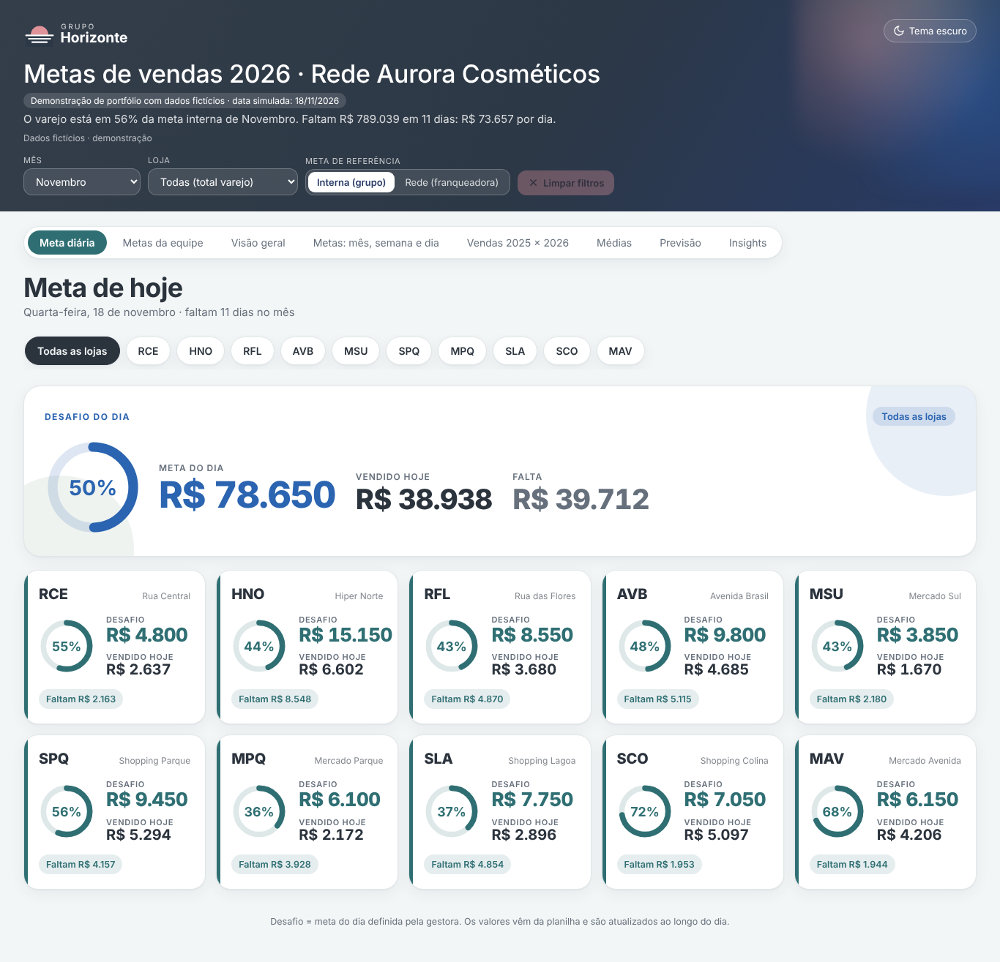
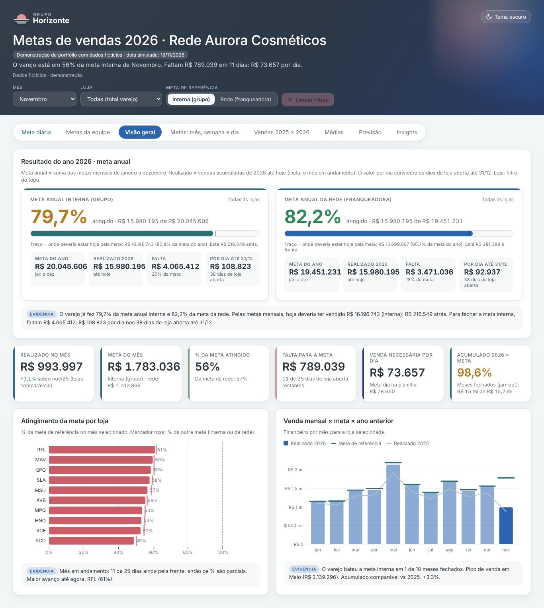
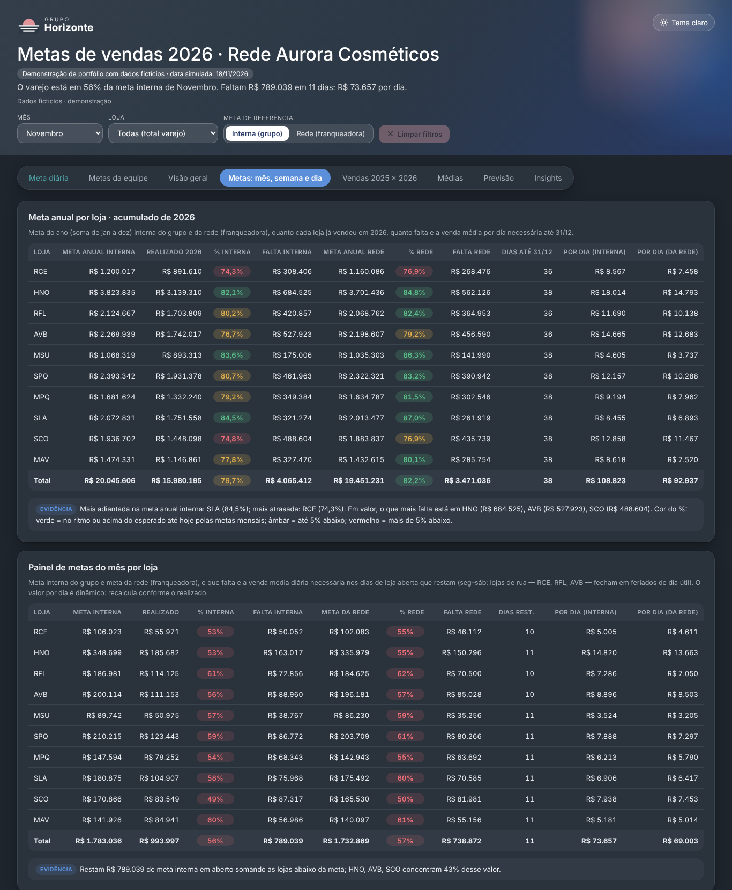
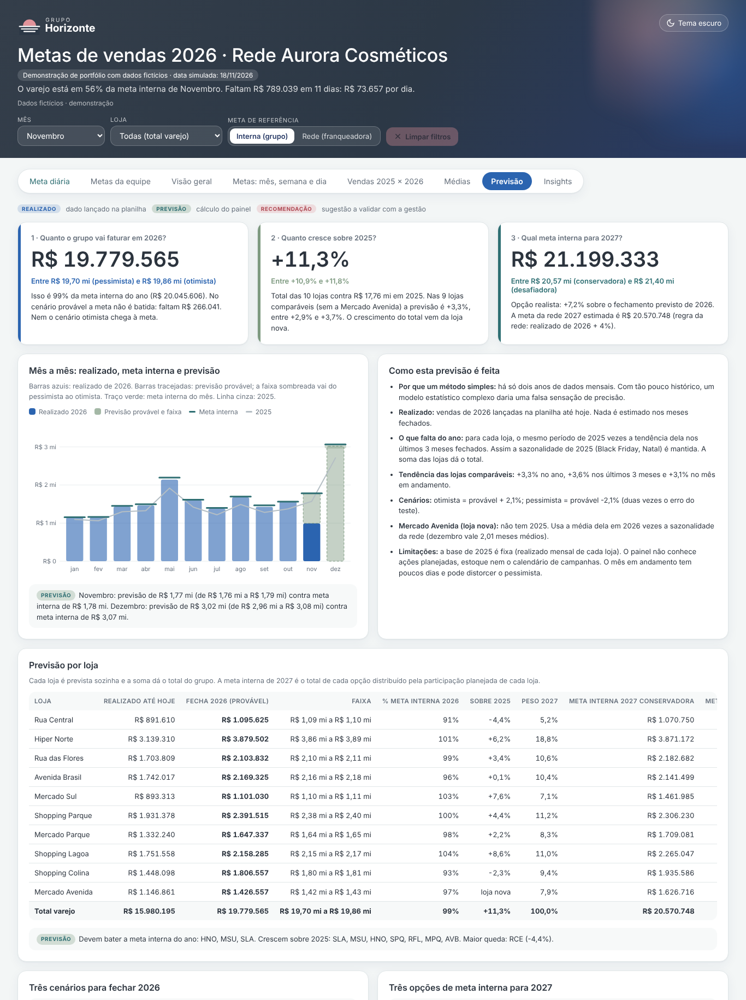
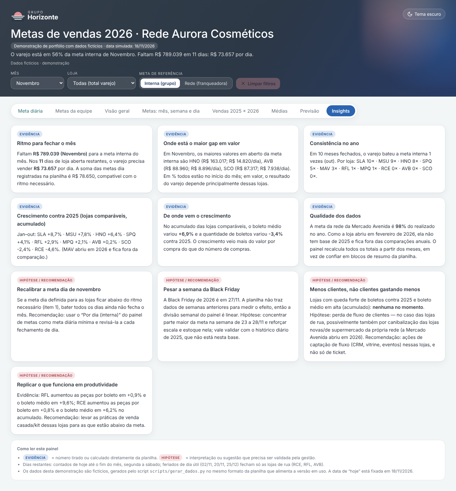

# Painel de metas de vendas para uma rede de franquias

Painel web que mostra, todos os dias, quanto cada loja precisa vender para fechar a meta, onde estão os maiores atrasos e como o ano deve terminar. Foi criado para os gestores de uma franqueada de cosméticos com 10 lojas, que acompanhavam as metas numa planilha grande e difícil de ler.

> **Dados fictícios.** Esta é a versão de portfólio. A empresa (Grupo Horizonte), a rede (Aurora Cosméticos), as lojas e todos os números são inventados e foram gerados pelo script `scripts/gerar_dados.py`. A lógica do painel é a mesma da versão usada no dia a dia. A data de "hoje" está fixada em 18/11/2026 para a demonstração funcionar a qualquer momento.



## O problema

As metas ficavam numa planilha com uma aba por mês, metas de duas origens (a meta interna do grupo e a meta da rede franqueadora) e blocos de resumo com fórmulas quebradas. Para responder perguntas simples, o gestor precisava abrir várias abas e fazer contas à mão:

- Quanto cada loja precisa vender **hoje** para fechar o mês?
- Quais lojas estão mais atrasadas, em percentual e em reais?
- O crescimento sobre o ano anterior vem de mais clientes ou de clientes gastando mais?
- Se o ritmo continuar, quanto o grupo fatura no ano? Qual meta faz sentido para o ano seguinte?

## O que o painel entrega

| Aba | Para quem | O que responde |
|---|---|---|
| Meta diária | Gerentes de loja | Desafio do dia, quanto já foi vendido e quanto falta, loja a loja |
| Metas da equipe | Equipe de vendas | A meta de hoje recalculada pelo que já foi vendido no mês |
| Visão geral | Diretoria | Meta anual, meta do mês, ranking das lojas e comparação com o ano anterior |
| Metas: mês, semana e dia | Gestão comercial | O que falta por loja, divisão por semana (com Black Friday e Natal) e histórico de atingimento em mapa de calor |
| Vendas 2025 × 2026 | Diretoria | Crescimento por loja em faturamento, peças e número de compras |
| Médias | Gestão comercial | Preço médio, boleto médio (valor por compra) e peças por compra |
| Previsão | Diretoria | Fechamento do ano em três cenários, teste do método nos meses passados e três opções de meta para o ano seguinte |
| Insights | Todos | Achados com a etiqueta **Evidência** (vem dos dados) ou **Hipótese** (precisa ser validada pela gestão) |

Filtros de mês, loja e meta de referência (interna ou da rede) valem para todas as abas. Há tema claro e escuro.



<details>
<summary>Ver as outras abas</summary>







</details>

## Decisões de análise

- **Meta diária dinâmica.** O que falta da meta é dividido pelos dias de loja aberta que restam (segunda a sábado). Lojas de rua fecham em feriado de dia útil, então têm menos dias e uma meta diária maior.
- **Comparação justa com o ano anterior.** No mês em andamento, o painel compara com os mesmos dias do ano anterior, não com o mês inteiro. A loja aberta em 2026 fica fora das comparações anuais.
- **Previsão simples e testada.** Com só dois anos de histórico, um modelo complexo daria falsa precisão. Cada loja repete, sobre o ano anterior, a tendência dos seus últimos 3 meses. O mesmo método é aplicado aos meses já fechados, e o erro médio desse teste define a largura dos cenários pessimista e otimista.
- **Decomposição do crescimento.** Faturamento = número de compras × valor médio por compra. Separar os dois mostra se a loja está perdendo clientes ou vendendo mais por cliente, o que pede ações diferentes.
- **Evidência separada de hipótese.** Todo texto do painel diz se o número saiu dos dados ou se é uma interpretação a validar.

## Como funciona

- `index.html`: o painel inteiro, em HTML, CSS e JavaScript, com gráficos em [D3.js](https://d3js.org/).
- `dados.json`: linhas mês × loja (faturamento, peças e número de compras de 2025 e 2026, metas interna e da rede, meta do dia).
- `scripts/gerar_dados.py`: gera o `dados.json` fictício com sazonalidade de varejo de cosméticos (Dia das Mães, Dia dos Pais, Black Friday e Natal).

Na versão em uso, o `dados.json` é substituído por uma função serverless na Vercel que lê a planilha da empresa publicada no Google Planilhas e devolve os dados no mesmo formato. O painel relê os dados a cada 5 minutos, então a gestão continua lançando vendas na planilha que já conhece.

## Como rodar

O painel é um site estático. Qualquer servidor local serve:

```
python -m http.server 8000
```

Depois abra http://localhost:8000. Para gerar outros dados fictícios, edite os parâmetros em `scripts/gerar_dados.py` e rode `python scripts/gerar_dados.py`.

## Ferramentas

JavaScript, D3.js, HTML e CSS · Python (geração de dados) · Google Planilhas como fonte · Vercel (hospedagem e função serverless) · desenvolvido com apoio de IA (Claude)

## Autor

Pedro Christo · [LinkedIn](https://www.linkedin.com/in/pedro-christo-9001b62b4/)
